# Primera traducción de voz — Instalación y solución de problemas

**Idiomas:** [Français](INSTALLATION_ET_DEPANNAGE.md) · [Español](INSTALLATION_ET_DEPANNAGE.es.md)

## Objetivo

Ejecutar el notebook de Python con una frase en español, escuchar la traducción al inglés y medir el tiempo de generación antes del ajuste fino (*fine-tuning*).

## Pruebas de instalación

| Prueba | Resultado observado | Causa |
| --- | --- | --- |
| Instalar Transformers 4.57.1 con la primera versión del notebook | pip sustituyó Transformers 5.22.1 e instaló Hugging Face Hub 0.36.2. | Gradio 6.31.0 y Gradio Client 2.7.2 requieren Hub 1.16 o superior. Diffusers 0.42.1 requiere Hub 1.32 o superior. |
| Restaurar Transformers 5.22.1 con Hub ≥ 1.32 y < 3 | pip instaló Hub 2.4.0 y notificó un nuevo conflicto. | Datasets 4.8.5, ya instalado en el entorno, exige Hub < 2. |
| Mantener Transformers 5.22.1 y limitar Hub a ≥ 1.32 y < 2 | pip desinstaló Hub 2.4.0 e instaló correctamente Hub 1.33.0. | El límite mínimo procede de Diffusers y el máximo de Datasets. Transformers y Gradio también aceptan este intervalo. |

El solucionador de dependencias debía encontrar una versión compatible. Diffusers exige como mínimo la versión 1.32 y Datasets exige una versión estrictamente inferior a 2. La versión 1.33.0 satisface ambos límites, así como los mínimos de Transformers 5.22.1 (1.31), Gradio y Gradio Client (1.16).

El mensaje « Successfully installed » confirma que pip instaló los paquetes solicitados. Para verificar todos los paquetes del entorno se utiliza `pip check`. En esta fase, las capturas muestran conflictos de instalación. Posteriormente se confirmó en Colab la carga del modelo en CPU y la primera traducción. También se ejecutó el ajuste fino piloto con una GPU T4.

## Continuar en Jupyter o Colab

1. Abrir el [notebook corregido](01_premiere_traduction.ipynb). Si ya hay una copia abierta, sustituir su celda de instalación por la siguiente.

   ~~~python
   %pip install "torch>=2.6" "transformers[sentencepiece]==5.22.1" "huggingface-hub>=1.32,<2" soundfile scipy
   ~~~

2. Reiniciar el kernel para que Python utilice las versiones recién instaladas. Ejecutar la siguiente celda para comprobar las dependencias.

   ~~~python
   %pip check
   ~~~

   Si pip sigue notificando un conflicto, anotar el nombre del paquete y el intervalo de versiones indicado antes de modificar la instalación.

3. Colocar un archivo WAV corto llamado `gracias_por_venir.wav` junto al notebook en Jupyter, o importarlo en el panel Archivos de Colab. Mantener el idioma de destino `eng` para la primera traducción.
4. Escuchar el original, cargar SeamlessM4T v2 y ejecutar la celda de traducción. Durante la primera carga, el notebook descarga los parámetros del modelo. La traducción de referencia esperada es « Thank you for coming. ».
5. Anotar la traducción realmente generada, comprobar su significado escuchando el audio y registrar el tiempo de generación mostrado.

## Advertencia HF_TOKEN en la primera descarga

Si el notebook muestra « You are sending unauthenticated requests to the HF Hub », la descarga se realiza sin iniciar sesión en Hugging Face. El modelo es público. **Mientras avance la barra de progreso, dejar que la celda continúe ejecutándose.** En nuestra prueba con Colab, la descarga continuó pese a la advertencia y mostraba un total aproximado de 9,24 GB.

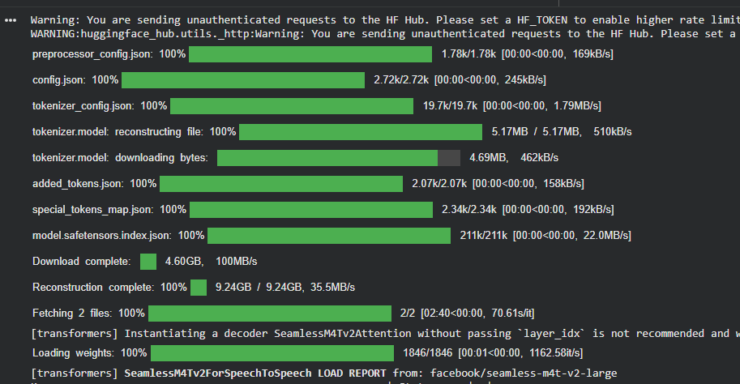

Esperar a que aparezca « Modèle chargé sur cpu. » o « Modèle chargé sur cuda. », según el dispositivo seleccionado, antes de ejecutar la celda de traducción. Si aparece un error **HTTP 429**, Hugging Face ha limitado la cantidad de solicitudes. Dejar que la descarga se reanude después del período indicado o utilizar un token de Hugging Face para beneficiarse de los límites de una cuenta autenticada. Si se utiliza Colab, guardar el token en sus secretos.

[Límites de solicitudes de Hugging Face Hub](https://huggingface.co/docs/hub/rate-limits)

## Informe de carga del modelo

En esta prueba, las líneas `UNEXPECTED` corresponden a los pesos de `text_encoder`. El modelo completo contiene un codificador de texto, mientras que la clase `SeamlessM4Tv2ForSpeechToSpeech` recibe audio y utiliza un codificador de voz. Por eso, estos pesos adicionales son esperables en este caso concreto. [Arquitectura de SeamlessM4T v2](https://huggingface.co/docs/transformers/model_doc/seamless_m4t_v2)

El mensaje **« Modèle chargé sur cpu. »** confirma que la celda de carga ha terminado. A continuación, ejecutar la celda **« Traduire et écouter »**. Estos mensajes se conservan en francés porque corresponden a los textos del notebook original.

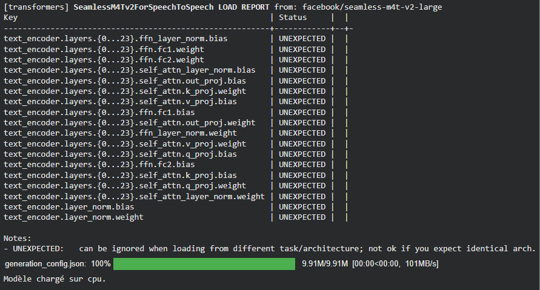

## IndexError después de generar el audio

Colab mostró `IndexError: invalid index of a 0-dim tensor` en la línea `result.waveform_lengths[0].item()`.

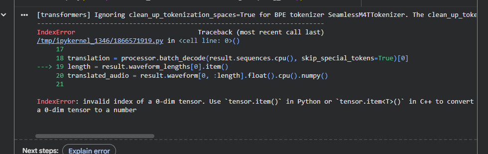

En Colab, SeamlessM4T devolvió la duración del audio en forma de tensor escalar, es decir, un único valor sin dimensiones. La celda anterior intentaba acceder al primer elemento mediante `[0]`, lo que provocaba el error después de generar el audio. El notebook procesa una sola frase y ahora lee este valor mediante `item()`.

Si el kernel sigue activo después del error, la variable `result` ya contiene el resultado. Basta con ejecutar las líneas de visualización corregidas en una nueva celda.

~~~python
length = result.waveform_lengths.item()
translated_audio = result.waveform.reshape(-1)[:length].float().cpu().numpy()
print(translation)
print(f"Temps de génération — {elapsed:.2f} s")
display(Audio(translated_audio, rate=model.config.sampling_rate))
~~~

El texto de salida dentro de `print` se mantiene en francés para que el fragmento coincida con el notebook original.

## Primera traducción confirmada en Colab

Después de corregir la visualización, el notebook mostró la traducción y el reproductor de audio a partir del resultado que ya se había generado.

| Elemento | Resultado observado |
| --- | --- |
| Frase original | « Gracias por venir » |
| Traducción generada | « Thank you for coming. » |
| Modelo y dispositivo | SeamlessM4T v2 preentrenado, ejecutado en CPU en Colab |
| Tiempo de generación | 64,09 segundos, sin incluir la carga del modelo |

El texto generado coincide con la traducción de referencia. Este tiempo corresponde a una sola prueba y sirve como punto de comparación para una ejecución en GPU con el mismo archivo.

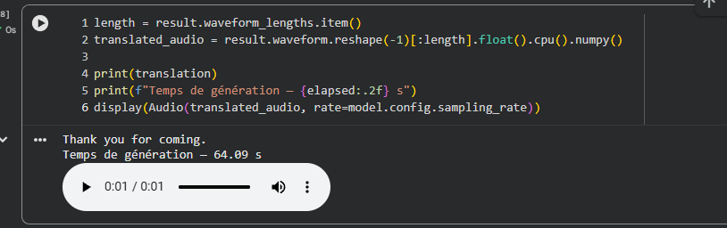

## Cambiar de CPU a GPU T4 en Colab

1. En Colab, abrir **Runtime → Change runtime type**. Mantener **Python 3**, seleccionar **T4 GPU** y hacer clic en **Save**.
2. En la nueva sesión, volver a ejecutar la celda de instalación y cargar otra vez el archivo de audio en el entorno. Para la comparación, utilizar la misma frase y mantener `tgt_lang = "eng"`.
3. En **« Charger le Transformer »**, establecer `use_gpu = True` y ejecutar la celda. Esperar el mensaje **« Modèle chargé sur cuda. »** antes de ejecutar **« Traduire et écouter »**.

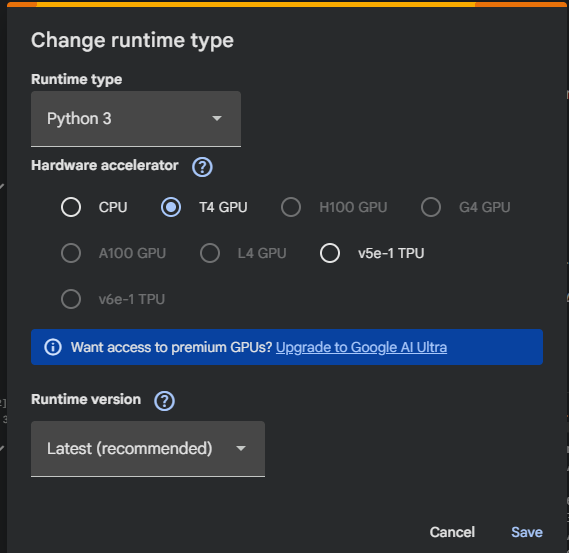

Al cambiar a la T4 se inició una nueva máquina virtual. Los archivos del modelo estaban almacenados en la caché del disco temporal de la sesión CPU. Como la nueva sesión no tenía esa caché, descargó de nuevo los mismos archivos en su propio disco. Los archivos temporales de Colab desaparecen cuando se elimina su máquina virtual. El notebook guardado y el archivo de audio original permanecen en su ubicación. [Preguntas frecuentes de Google Colab](https://research.google.com/colaboratory/faq.html)

La captura muestra dos etapas. **« Fetching 2 files: 100% »** confirma que los archivos se descargaron. **« Loading weights »** indica que el programa está cargando los parámetros del modelo. En esta prueba, la celda mostraba **5 min 41 s** al comienzo de la carga de los pesos. Para comparar con la medición de **64,09 s** en CPU, se debe registrar únicamente el **tiempo de generación** mostrado por la celda de traducción.

El notebook utiliza FP32 en CPU y FP16 en GPU. Por lo tanto, se comparan estas dos configuraciones de ejecución.

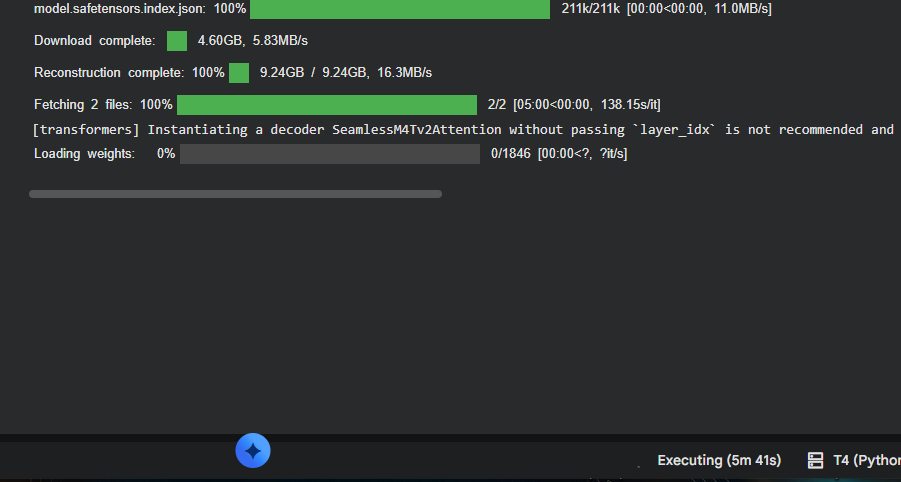

## Hardware utilizado

| Entorno | Hardware | Función en el proyecto |
| --- | --- | --- |
| Colab en modo CPU | Procesador de la máquina virtual. No se registraron su modelo ni la cantidad de RAM durante esta prueba. | Primera prueba de traducción en FP32. |
| Colab en modo GPU | NVIDIA T4 con 16 GB de memoria de video GDDR6, según la ficha del fabricante. | Segunda prueba de traducción con CUDA y pesos cargados en FP16. |
| Computadora personal | Intel Core i7-4770K a 3,50 GHz y NVIDIA GeForce GTX 1080 con 8 GiB de memoria de video, identificados en Windows. | Preparación del proyecto y acceso a Colab. Los dos tiempos de generación se midieron en las máquinas virtuales de Colab. |

La CPU es el procesador de propósito general. La T4 incorpora unidades diseñadas para realizar en paralelo los cálculos matriciales utilizados por el Transformer. El notebook utiliza números de 32 bits (FP32) en CPU y pesos de 16 bits (FP16) en GPU. FP16 reduce el espacio requerido para almacenar esos pesos en memoria. Por tanto, la comparación combina un cambio de hardware con un cambio de precisión. [Ficha técnica de NVIDIA T4](https://www.nvidia.com/fr-fr/data-center/tesla-t4/)

Para consultar el hardware en una ejecución futura, ejecutar `!lscpu` en una celda de Colab. Con una GPU activada, utilizar `!nvidia-smi --query-gpu=name,memory.total --format=csv` para mostrar su nombre y la memoria de video disponible en la sesión.

## Comparación de los tiempos de generación

Las dos pruebas utilizaron la misma grabación (« Gracias por venir ») y el mismo idioma de destino: inglés. El notebook mostró « Thank you for coming. » y un reproductor de audio en ambos casos.

| Configuración de Colab | Tiempo de generación |
| --- | ---: |
| CPU, FP32 | 64,09 s |
| T4, FP16 | 8,57 s |

En esta prueba, el tiempo de generación con T4 fue **86,6 % menor**, equivalente a **55,52 s menos**. Las mediciones excluyen la descarga, la carga y la visualización del resultado. Se realizó una medición por configuración, con diferente precisión numérica en cada una.

La captura muestra que la celda anterior reprodujo el IndexError en T4. La celda de recuperación mostró el resultado ya generado y su tiempo de generación. El notebook corregido incorpora esta etapa.

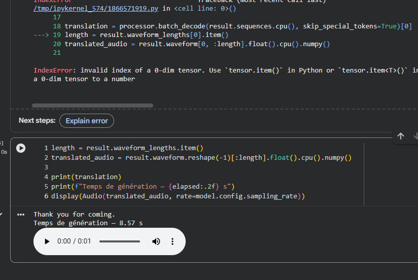

## Segundo ejemplo con T4

| Elemento | Resultado observado |
| --- | --- |
| Frase original | « No puedo llegar antes de las ocho. » |
| Traducción de referencia | « I can’t arrive before eight. » |
| Traducción generada | « I can't get there before eight. » |
| Tiempo de generación | 3,06 s en T4, sin incluir la carga del modelo |

« I can't » conserva la negación y « before eight » mantiene el límite horario. En este contexto, « get there » transmite la misma idea que « arrive ». Esta segunda prueba ilustra la conservación del significado en otra frase. Para comparar los tiempos de dos configuraciones, es necesario utilizar el mismo archivo de audio.

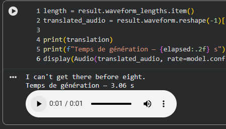

## Validación antes del ajuste fino

El notebook 03 evaluó el modelo preentrenado con los cuatro pares de validación de FLEURS. La pérdida media fue de **1,3135**. Este valor mide la diferencia entre las predicciones del modelo y las unidades de texto de referencia. Sirve como punto de comparación para la medición posterior al ajuste fino sobre los mismos cuatro ejemplos.

| Elemento | Texto |
| --- | --- |
| Referencia | It is Martelly's fifth CEP in four years. |
| Predicción antes del ajuste fino | In four years, he's the fifth Sept of Martelli. |

La predicción conserva « four years », pero convierte « CEP » en « Sept », cambia « Martelly » por « Martelli » y modifica la relación entre la persona y el CEP. Por lo tanto, el significado de la frase queda alterado.

## Resultado del ajuste fino piloto

El notebook 03 completó las **16 etapas** con los 16 pares de entrenamiento. Los **cuatro tensores modificados** corresponden a los pesos y sesgos de las dos proyecciones seleccionadas en el decodificador.

| Indicador | Antes | Después |
| --- | --- | --- |
| Pérdida media en los mismos cuatro pares de validación | 1,3135 | 1,3129 |
| Traducción del ejemplo mostrado | In four years, he's the fifth Sept of Martelli. | In four years, he's the fifth Sept of Martelli. |

Según los valores mostrados, la pérdida de validación disminuyó **0,0006**. La traducción del ejemplo permaneció idéntica y todavía contiene errores en « CEP » y « Martelly ». Con solo cuatro pares de validación, esta variación de pérdida no basta para demostrar una mejora de la traducción. La prueba piloto confirma que el programa modificó los parámetros y pudo volver a evaluarlos. A continuación se presenta una primera comparación con dos grabaciones personales.

Las pérdidas de las 16 etapas corresponden a frases diferentes. Su variación entre una línea y otra también refleja la dificultad de cada frase.

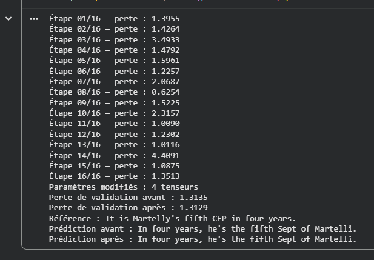

Después de esta celda, ejecutar **« Sauvegarder le résultat »** y descargar `fine_tuning_pilote.zip` desde el panel Archivos. El ZIP contiene los pesos ajustados y el informe JSON.

## Comparación de voz antes y después del ajuste fino

El notebook 04 utilizó las mismas dos grabaciones personales, primero con los pesos originales y después con los cuatro tensores ajustados. Estas grabaciones son distintas de los pares de FLEURS empleados para el ajuste fino. El notebook mostró el texto generado y un reproductor de audio para cada versión.

| Frase original | Antes del ajuste fino | Después del ajuste fino |
| --- | --- | --- |
| Gracias por venir. | Thank you for coming. | Thank you for coming. |
| No puedo llegar antes de las ocho. | I can't get there before eight. | I can't get there before eight. |

Las dos versiones conservan el significado de ambas frases. En el segundo ejemplo, « I can't » mantiene la negación y « before eight » conserva el límite horario. Los textos generados son idénticos para las dos grabaciones. La captura confirma la presencia de los reproductores de audio, pero no permite determinar si las dos señales de audio son idénticas.

Estos dos ejemplos no muestran una mejora de la traducción después del ajuste piloto. A continuación se presenta una primera prueba con dos niveles de voz.

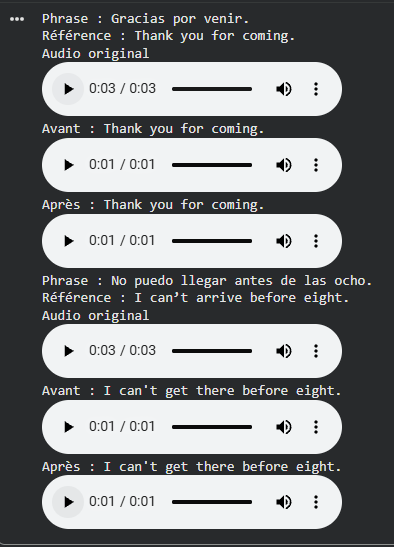

## Primera prueba con dos niveles de voz

La frase « No puedo llegar antes de las ocho » se grabó dos veces. Ambas versiones del modelo generaron « I can't get there before eight. » en cada grabación. El texto conserva la negación y el límite horario en las cuatro salidas.

| Grabación | Nivel RMS registrado |
| --- | ---: |
| Voz normal | −35,0 dBFS |
| Voz baja | −27,8 dBFS |

En dBFS, un valor más cercano a cero corresponde a una señal más fuerte. Por tanto, la grabación etiquetada como « voz baja » era **7,2 dB más fuerte** en el conjunto del archivo. Las cuatro salidas muestran que el modelo tradujo ambas grabaciones. Para estudiar el efecto de un nivel más bajo, habrá que repetirlas y comprobar que la grabación de voz baja tenga un RMS más negativo. Se debe mantener el mismo micrófono y la misma distancia, con silencios comparables al principio y al final.

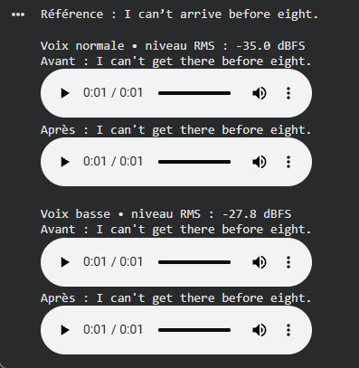

### Segunda grabación con diferencia de nivel medida

Se volvió a grabar la misma frase. El nivel RMS fue de **−28,1 dBFS** para la voz normal y de **−38,4 dBFS** para la voz baja, es decir, **10,3 dB menos** en la segunda grabación. Esta vez los niveles registrados corresponden a las condiciones previstas.

Las dos versiones generaron « I can't get there before eight. » en ambas condiciones. La negación y el límite horario se conservaron en los cuatro textos. Este resultado describe una frase y dos grabaciones. La captura permite comprobar los textos y la presencia de los reproductores.

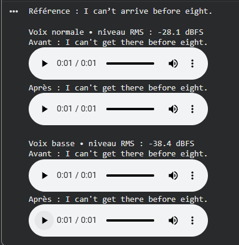

### Segunda frase probada con voz normal y voz baja

Para « Necesito dos boletos para mañana », el nivel RMS fue de **−26,0 dBFS** con voz normal y de **−36,9 dBFS** con voz baja. La grabación de voz baja fue **10,9 dB más débil**.

Las cuatro traducciones mostradas fueron « I need two tickets for tomorrow. ». El modelo conservó la cantidad (« two tickets ») y la indicación temporal (« tomorrow ») en ambas grabaciones, antes y después del ajuste fino. Ya se han probado dos de las seis frases previstas con una diferencia de nivel confirmada.

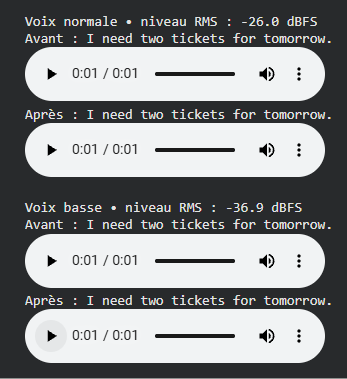

### Tercera frase probada con voz normal y voz baja

Para « El tren sale a las siete y media », el nivel RMS fue de **−26,4 dBFS** con voz normal y de **−36,7 dBFS** con voz baja. La segunda grabación fue **10,3 dB más débil**.

Las cuatro salidas mostraron « The train leaves at half past seven. ». La traducción conservó la salida del tren y la hora en ambas grabaciones, antes y después del ajuste fino. Ya se han probado tres de las seis frases previstas con una diferencia de nivel confirmada.

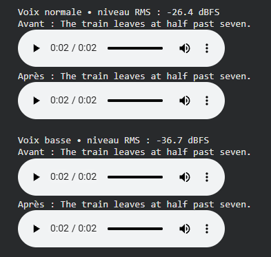

### Cuarta frase probada con voz normal y voz baja

Para « La farmacia está al lado del banco », el nivel RMS fue de **−26,7 dBFS** con voz normal y de **−34,4 dBFS** con voz baja. La segunda grabación fue **7,7 dB más débil**.

Las cuatro salidas mostraron « The pharmacy is next to the bank. ». Conservaron ambos lugares y su relación espacial. Ya se han probado cuatro de las seis frases previstas con una diferencia de nivel confirmada.

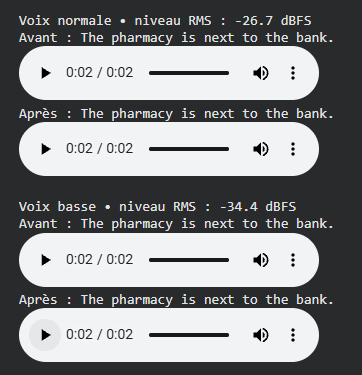

### Quinta frase probada con voz normal y voz baja

Para « No olvides llevar el pasaporte », el nivel RMS fue de **−25,6 dBFS** con voz normal y de **−33,6 dBFS** con voz baja. La segunda grabación fue **8,0 dB más débil**.

Las cuatro salidas mostraron « Don't forget to bring your passport. ». Conservaron la instrucción de no olvidar el pasaporte. Ya se han probado cinco de las seis frases previstas con una diferencia de nivel confirmada.

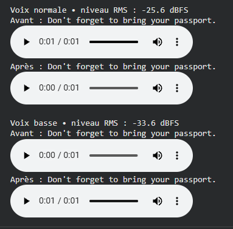

### Sexta frase probada con voz normal y voz baja

Para « Gracias por venir », el nivel RMS fue de **−27,7 dBFS** con voz normal y de **−40,1 dBFS** con voz baja, una diferencia de **12,4 dB**.

Con voz normal, las dos versiones produjeron « Thank you for coming. ». Con voz baja, ambas produjeron « Thank you, Dad. ». Se conserva el agradecimiento, pero el modelo elimina el motivo del agradecimiento y añade « Dad », que no aparece en la frase original.

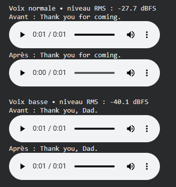

### Resumen de las seis frases

La fidelidad del significado se evaluó a partir de los textos de traducción mostrados. Ambas versiones produjeron el mismo texto para cada una de las doce grabaciones.

| Condición | Significado conservado antes del ajuste fino | Significado conservado después del ajuste fino |
| --- | ---: | ---: |
| Voz normal | 6 de 6 | 6 de 6 |
| Voz baja | 5 de 6 | 5 de 6 |
| Total | 11 de 12 | 11 de 12 |

El ajuste fino piloto no modificó las traducciones escritas de esta prueba. El único error de significado apareció en una grabación con voz baja. Los resultados corresponden a una voz, un micrófono y seis frases. No permiten establecer un umbral de volumen ni atribuir exclusivamente al volumen la causa del error.

## Demostración de español a francés

Con los pesos originales y el idioma de destino `fra`, el traductor procesó la grabación con voz normal « Necesito dos boletos para mañana ». Mostró **« J’ai besoin de deux billets pour demain. »** y generó un audio en francés. La traducción conserva la cantidad y el día.

Este ejemplo ilustra otra dirección de traducción. La evaluación del ajuste fino corresponde a la dirección español → inglés.

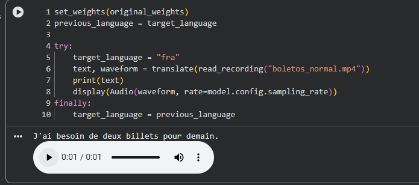

### Otro ejemplo en francés

Para la frase sobre el tren, el modelo mostró « Le train sort à sept et demi. ». El significado general y la hora siguen siendo reconocibles. Una expresión más natural sería **« Le train part à sept heures et demie. »**. Para la salida de un tren, « part » es más adecuado que « sort ». En esta construcción, « demie » concuerda con « heure ».

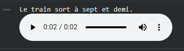

### Ambigüedad de la palabra « banco »

Para « La farmacia está al lado del banco », el modelo generó « La pharmacie est au côté du banc. ». Interpretó « banco » como un asiento. Sin embargo, en este ejemplo la referencia era una entidad financiera. La traducción esperada es **« La pharmacie est à côté de la banque. »**. La salida conserva la relación espacial, pero cambia el punto de referencia. La frase aislada en español permite ambas interpretaciones. Esta observación corresponde a la demostración hacia el francés.

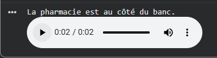

### Elección del verbo en la frase del pasaporte

Para « No olvides llevar el pasaporte », el modelo mostró « n'oubliez pas de porter le passeport. ». La instrucción se entiende, pero en este contexto **« N’oublie pas d’emporter ton passeport. »** expresa de manera más natural la idea de llevar el pasaporte consigo y mantiene el trato informal de la frase española.

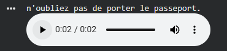

### Forma natural de expresar el agradecimiento

Para « Gracias por venir », el modelo mostró « Merci pour venir. ». El mensaje se puede entender. Sin embargo, en francés, **« Merci d’être venu. »** o **« Merci d’être venue. »**, según la persona, expresan de forma más natural el agradecimiento por su presencia.

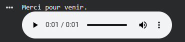

## Fuentes sobre la instalación

Las versiones instaladas y los conflictos proceden de los registros de pip. Los responsables de las bibliotecas documentan las restricciones de Transformers y la publicación de Hub 1.33.0.

- [Dependencias de Transformers 5.22.1](https://github.com/huggingface/transformers/blob/v5.22.1/setup.py)
- [Versiones de Hugging Face Hub en PyPI](https://pypi.org/project/huggingface-hub/#history)
- [Documentación de pip check](https://pip.pypa.io/en/stable/cli/pip_check/)
