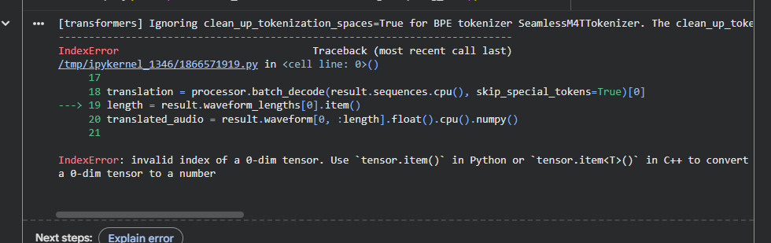
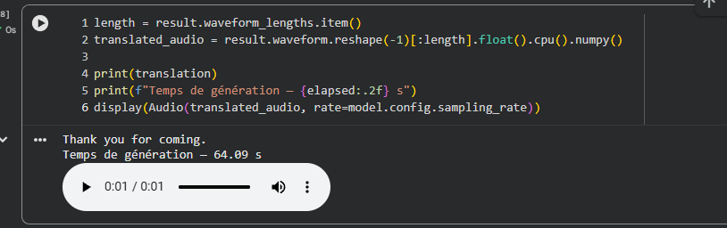
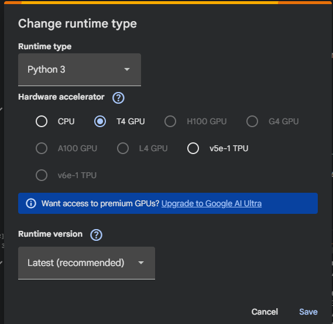
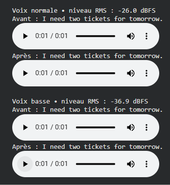
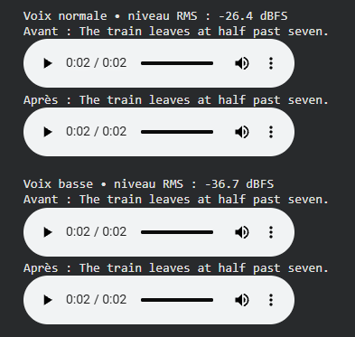

# Première traduction vocale — Installation et dépannage

## Objectif

Exécuter le notebook Python sur une phrase espagnole, écouter la traduction
anglaise et mesurer le temps de génération avant le fine-tuning.

## Essais d’installation

| Essai | Résultat observé | Cause |
| --- | --- | --- |
| Installer Transformers 4.57.1 avec la première version du notebook | pip a remplacé Transformers 5.22.1 et installé Hugging Face Hub 0.36.2. | Gradio 6.31.0 et Gradio Client 2.7.2 demandent Hub 1.16 ou plus. Diffusers 0.42.1 demande Hub 1.32 ou plus. |
| Rétablir Transformers 5.22.1 avec Hub ≥ 1.32 et < 3 | pip a installé Hub 2.4.0 et a signalé un nouveau conflit. | Datasets 4.8.5, déjà installé dans l’environnement, exige Hub < 2. |
| Conserver Transformers 5.22.1 et limiter Hub à ≥ 1.32 et < 2 | pip a désinstallé Hub 2.4.0 et installé Hub 1.33.0 avec succès. | Le minimum vient de Diffusers et le maximum vient de Datasets. Transformers et Gradio acceptent aussi cette plage. |

Le résolveur devait trouver une version commune. Diffusers exige au moins
la version 1.32 et Datasets exige une version strictement inférieure à 2.
La version 1.33.0 respecte ces deux limites. Elle respecte aussi le minimum
de Transformers 5.22.1 (1.31) et celui de Gradio et Gradio Client (1.16).

La ligne « Successfully installed » confirme que pip a installé les paquets
demandés. La vérification de l’ensemble des paquets de l’environnement se fait
avec pip check. À ce stade, les captures montrent des conflits d’installation.
Le chargement sur CPU et la première traduction ont ensuite été confirmés
dans Colab. Le fine-tuning pilote a également été exécuté sur T4.

## Reprendre dans Jupyter ou Colab

1. Ouvrir [le notebook corrigé](01_premiere_traduction.ipynb). Si une copie est
   déjà ouverte, remplacer sa cellule d’installation par celle-ci.

   ~~~python
   %pip install "torch>=2.6" "transformers[sentencepiece]==5.22.1" "huggingface-hub>=1.32,<2" soundfile scipy
   ~~~

2. Redémarrer le noyau pour que Python utilise les versions qui viennent
   d’être installées. Exécuter la cellule suivante pour vérifier les dépendances.

   ~~~python
   %pip check
   ~~~

   Si pip signale encore un conflit, relever le nom du paquet et la plage
   de versions indiquée avant de modifier l’installation.

3. Placer un fichier WAV court nommé gracias_por_venir.wav à côté du notebook
   dans Jupyter ou l’importer dans le panneau Fichiers de Colab. Garder la langue
   cible eng pour la première traduction.
4. Écouter l’original, charger SeamlessM4T v2, puis exécuter la cellule de
   traduction. Au premier chargement, le notebook télécharge les paramètres
   du modèle. La référence attendue est « Thank you for coming. »
5. Noter la traduction réellement produite, vérifier le sens en écoutant
   l’audio et relever le temps de génération affiché.

## Avertissement HF_TOKEN au premier téléchargement

Si le notebook affiche « You are sending unauthenticated requests to the HF
Hub », le téléchargement se fait sans connexion à un compte Hugging Face.
Le modèle est public. **Tant que la barre de progression avance, laissez la
cellule s’exécuter.** Lors de notre essai dans Colab, le téléchargement
avançait malgré cet avertissement et affichait un total d’environ 9,24 Go.

Attendez le message « Modèle chargé sur cpu. » ou « Modèle chargé sur cuda. »,
selon l’appareil choisi, avant d’exécuter la cellule de traduction. Si une
erreur **HTTP 429** apparaît, Hugging Face a limité le nombre de requêtes.
Laissez le téléchargement reprendre après le délai indiqué ou utilisez un
jeton Hugging Face pour bénéficier des limites d’un compte connecté. Gardez
le jeton dans les secrets de Colab si vous utilisez cet environnement.

[Limites de requêtes sur Hugging Face Hub](https://huggingface.co/docs/hub/rate-limits)

## Rapport de chargement du modèle

Dans cet essai, les lignes `UNEXPECTED` concernent les poids de
`text_encoder`. Le modèle complet contient un encodeur de texte, tandis
que la classe `SeamlessM4Tv2ForSpeechToSpeech` reçoit de l’audio et utilise
un encodeur vocal. Ces poids supplémentaires sont donc attendus dans ce
cas précis. [Architecture de SeamlessM4T v2](https://huggingface.co/docs/transformers/model_doc/seamless_m4t_v2)

**« Modèle chargé sur cpu. »** confirme que la cellule de chargement est
terminée. Lancez ensuite la cellule **« Traduire et écouter »**.

## IndexError après la génération de l’audio

Colab a affiché `IndexError: invalid index of a 0-dim tensor` sur la ligne
`result.waveform_lengths[0].item()`.

Dans Colab, SeamlessM4T a renvoyé la longueur de l’audio sous la forme d’un
tenseur scalaire, c’est-à-dire une seule valeur sans dimension. L’ancienne
cellule essayait d’en lire le premier élément avec [0], ce qui provoquait
une erreur après la génération. Le notebook traite une seule phrase et
lit maintenant cette valeur avec item().

Si le noyau est toujours actif après cette erreur, la variable result
contient déjà le résultat. Il suffit d’exécuter les lignes d’affichage
corrigées dans une nouvelle cellule.

~~~python
length = result.waveform_lengths.item()
translated_audio = result.waveform.reshape(-1)[:length].float().cpu().numpy()
print(translation)
print(f"Temps de génération — {elapsed:.2f} s")
display(Audio(translated_audio, rate=model.config.sampling_rate))
~~~

## Première traduction confirmée dans Colab

Après la correction de l’affichage, le notebook a affiché la traduction et
le lecteur audio à partir du résultat déjà généré.

| Élément | Résultat observé |
| --- | --- |
| Phrase source | « Gracias por venir » |
| Traduction générée | « Thank you for coming. » |
| Modèle et appareil | SeamlessM4T v2 préentraîné, sur CPU dans Colab |
| Temps de génération | 64,09 secondes, hors chargement du modèle |

La sortie écrite correspond à la traduction de référence. Ce temps est la
mesure d’un seul essai et servira de point de comparaison pour une exécution
sur GPU avec le même fichier.

## Passer du CPU à la GPU T4 dans Colab

1. Dans Colab, ouvrir **Runtime → Change runtime type**. Garder **Python 3**,
   sélectionner **T4 GPU** et cliquer sur **Save**.
2. Dans la nouvelle session, relancer la cellule d’installation et remettre le
   fichier audio dans l’environnement. Pour la comparaison, utiliser la même
   phrase et conserver `tgt_lang = "eng"`.
3. Dans **« Charger le Transformer »**, mettre `use_gpu = True` et exécuter
   la cellule. Attendre **« Modèle chargé sur cuda. »** avant de lancer
   **« Traduire et écouter »**.

Le passage à la T4 a ouvert une nouvelle machine virtuelle. Les fichiers du
modèle se trouvaient dans le cache du disque temporaire de la session CPU.
Comme la nouvelle session n’avait pas ce cache, elle a téléchargé les mêmes
fichiers sur son propre disque. Les fichiers temporaires de Colab disparaissent
quand leur machine virtuelle est supprimée. Le notebook sauvegardé et le fichier
audio original restent à leur emplacement. [FAQ de Google Colab](https://research.google.com/colaboratory/faq.html)

La capture montre deux étapes. **« Fetching 2 files: 100% »** confirme que
les fichiers ont été récupérés. **« Loading weights »** indique que le
programme charge ensuite les paramètres du modèle. Dans cet essai, la cellule
affichait **5 min 41 s** au début du chargement des poids. Pour comparer à
la mesure CPU de **64,09 s**, relever uniquement le **temps de génération**
affiché par la cellule de traduction.
Le notebook utilise FP32 sur CPU et FP16 sur GPU. La comparaison portera
donc sur ces deux configurations d’exécution.

## Matériel utilisé

| Environnement | Matériel | Rôle dans le projet |
| --- | --- | --- |
| Colab en mode CPU | Processeur de la machine virtuelle. Son modèle et sa RAM n’ont pas été relevés pour cet essai. | Premier essai de traduction en FP32. |
| Colab en mode GPU | NVIDIA T4 avec 16 Go de mémoire vidéo GDDR6 selon la fiche du fabricant. | Deuxième essai de traduction avec CUDA et des poids chargés en FP16. |
| Ordinateur personnel | Intel Core i7-4770K à 3,50 GHz et NVIDIA GeForce GTX 1080 avec 8 Gio de mémoire vidéo, identifiés sous Windows. | Préparation du projet et accès à Colab. Les deux temps de génération ont été mesurés sur les machines virtuelles de Colab. |

Le CPU est le processeur généraliste. La T4 possède des unités conçues pour
effectuer en parallèle les calculs matriciels utilisés par le Transformer.
Le notebook utilise des nombres sur 32 bits (FP32) sur CPU et sur 16 bits
(FP16) pour les poids chargés sur GPU. Le FP16 réduit l’espace nécessaire
pour stocker ces poids en mémoire. La comparaison combine donc un changement
de matériel et un changement de précision. [Fiche technique de la NVIDIA T4](https://www.nvidia.com/fr-fr/data-center/tesla-t4/)

Pour relever le matériel lors d’une prochaine exécution, lancer `!lscpu`
dans une cellule Colab. Avec une GPU activée, utiliser
`!nvidia-smi --query-gpu=name,memory.total --format=csv` pour afficher
son nom et la mémoire vidéo visible par la session.

## Comparaison des temps de génération

Les deux essais ont utilisé le même enregistrement (« Gracias por venir »)
et la même langue cible, l’anglais. Le notebook a affiché « Thank you for
coming. » et un lecteur audio dans les deux cas.

| Configuration Colab | Temps de génération |
| --- | ---: |
| CPU, FP32 | 64,09 s |
| T4, FP16 | 8,57 s |

Dans cet essai, le temps de génération sur T4 était inférieur de **86,6 %**,
soit **55,52 s** de moins. Les mesures excluent le téléchargement, le
chargement et l’affichage du résultat. Il s’agit d’une mesure par
configuration, avec une précision numérique différente entre les deux.

La capture montre que l’ancienne cellule a reproduit l’IndexError sur T4.
La cellule de récupération a affiché le résultat déjà généré et son temps
de génération. Le notebook corrigé intègre cette étape.

## Deuxième exemple sur T4

| Élément | Résultat observé |
| --- | --- |
| Phrase source | « No puedo llegar antes de las ocho. » |
| Traduction de référence | « I can’t arrive before eight. » |
| Traduction générée | « I can't get there before eight. » |
| Temps de génération | 3,06 s sur T4, hors chargement du modèle |

« I can't » conserve la négation et « before eight » conserve la limite
horaire. Dans ce contexte, « get there » transmet la même idée que « arrive ».
Ce deuxième essai illustre la fidélité du sens sur une autre phrase. Pour
comparer les temps de deux configurations, on utilise le même fichier audio.

## Validation avant le fine-tuning

Le notebook 03 a évalué le modèle préentraîné sur les quatre paires de
validation de FLEURS. La perte moyenne était de **1,3135**. Cette valeur
mesure l’écart entre les prédictions du modèle et les unités de texte de
référence. Elle sert de point de comparaison pour la mesure après le
fine-tuning sur les quatre mêmes exemples.

| Élément | Texte |
| --- | --- |
| Référence | It is Martelly's fifth CEP in four years. |
| Prédiction avant le fine-tuning | In four years, he's the fifth Sept of Martelli. |

La prédiction conserve « four years », mais rend « CEP » par « Sept »,
change « Martelly » en « Martelli » et transforme la relation entre la
personne et le CEP. Le sens de la phrase est donc altéré.

## Résultat du fine-tuning pilote

Le notebook 03 a terminé les **16 étapes** sur les 16 paires
d’entraînement. Les **quatre tenseurs modifiés** correspondent aux poids
et aux biais des deux projections sélectionnées dans le décodeur.

| Indicateur | Avant | Après |
| --- | --- | --- |
| Perte moyenne sur les quatre mêmes paires de validation | 1,3135 | 1,3129 |
| Traduction de l’exemple affiché | In four years, he's the fifth Sept of Martelli. | In four years, he's the fifth Sept of Martelli. |

La perte de validation a diminué de **0,0006** d’après les valeurs affichées.
La traduction de l’exemple est restée identique et contient encore les erreurs
sur « CEP » et « Martelly ». Sur quatre paires de validation, cette variation
de perte ne suffit pas à établir une amélioration de la traduction. Le pilote
confirme que le programme a modifié les paramètres et a pu les réévaluer.
Une première comparaison sur deux enregistrements personnels est présentée ci-dessous.

Les pertes des 16 étapes se rapportent à des phrases différentes. Leur
variation d’une ligne à l’autre reflète aussi la difficulté de chaque phrase.

Après cette cellule, exécuter **« Sauvegarder le résultat »** et télécharger
`fine_tuning_pilote.zip` depuis le panneau Fichiers. Le ZIP contient les
poids ajustés et le rapport JSON.

## Comparaison vocale avant et après le fine-tuning

Le notebook 04 a utilisé les deux mêmes enregistrements personnels avec les
poids d’origine, puis avec les quatre tenseurs ajustés. Ces enregistrements
sont distincts des paires de FLEURS utilisées pour le fine-tuning. Le notebook
a affiché le texte généré et un lecteur audio pour chaque version.

| Phrase source | Avant le fine-tuning | Après le fine-tuning |
| --- | --- | --- |
| Gracias por venir. | Thank you for coming. | Thank you for coming. |
| No puedo llegar antes de las ocho. | I can't get there before eight. | I can't get there before eight. |

Les deux versions conservent le sens des deux phrases. Dans le deuxième
exemple, « I can't » conserve la négation et « before eight » la limite
horaire. Les textes générés sont identiques pour ces deux enregistrements.
La capture confirme la présence des lecteurs audio. Elle ne permet pas
d’établir si les deux signaux audio sont identiques.

Ces deux exemples ne montrent pas d’amélioration de la traduction après
l’ajustement pilote. Un premier essai avec deux niveaux de voix est présenté
ci-dessous.

## Premier essai à deux niveaux de voix

La phrase « No puedo llegar antes de las ocho » a été enregistrée deux
fois. Les deux versions du modèle ont produit « I can't get there before
eight. » pour chacune des prises. Le texte conserve la négation et la limite
horaire dans les quatre sorties.

| Prise | Niveau RMS enregistré |
| --- | ---: |
| Voix normale | −35,0 dBFS |
| Voix basse | −27,8 dBFS |

En dBFS, un niveau plus proche de zéro correspond à un signal plus fort.
La prise étiquetée « voix basse » était donc plus forte de **7,2 dB** sur
l’ensemble du fichier. Les quatre sorties montrent que le modèle a traduit
les deux prises. Pour étudier l’effet d’un niveau plus faible, il faudra
refaire les prises et vérifier que la prise basse a un RMS plus négatif.
Il faut garder le même micro et la même distance, avec des silences
comparables au début et à la fin.

### Deuxième prise avec un contraste mesuré

La même phrase a été réenregistrée. Le niveau RMS était de **−28,1 dBFS**
pour la voix normale et de **−38,4 dBFS** pour la voix basse, soit **10,3 dB
de moins** pour la prise basse. Les niveaux enregistrés correspondent
cette fois aux conditions prévues.

Les deux versions ont produit « I can't get there before eight. » dans
les deux conditions. La négation et l’heure limite ont été conservées dans
les quatre textes. Ce résultat décrit une phrase et deux prises. La
capture permet de vérifier les textes et la présence des lecteurs.

### Deuxième phrase testée à voix normale et basse

Pour « Necesito dos boletos para mañana », le niveau RMS était de
**−26,0 dBFS** à voix normale et de **−36,9 dBFS** à voix basse. La prise
basse était donc **10,9 dB** plus faible.

Les quatre traductions affichées étaient « I need two tickets for
tomorrow. » Le modèle a conservé la quantité (« two tickets ») et
l’indication de temps (« tomorrow ») dans les deux prises, avant et après
le fine-tuning. Deux des six phrases prévues ont maintenant été testées
avec un contraste de niveau confirmé.

### Troisième phrase testée à voix normale et basse

Pour « El tren sale a las siete y media », le niveau RMS était de
**−26,4 dBFS** à voix normale et de **−36,7 dBFS** à voix basse. La prise
basse était donc **10,3 dB** plus faible.

Les quatre sorties ont donné « The train leaves at half past seven. »
La traduction a conservé le départ du train et l’heure dans les deux prises,
avant et après le fine-tuning. Trois des six phrases prévues ont été testées
avec un contraste de niveau confirmé.

## Démonstration espagnol vers français

Avec les poids d’origine et la langue cible `fra`, le traducteur a traité
la prise normale « Necesito dos boletos para mañana ». Il a affiché
**« J’ai besoin de deux billets pour demain. »** et généré un audio en
français. La traduction conserve la quantité et le jour.

Cet exemple illustre une autre direction de traduction. L’évaluation du
fine-tuning porte sur la direction espagnol → anglais.

### Autre exemple en français

Pour la phrase sur le train, le modèle a affiché « Le train sort à sept et
demi. » Le sens général et l’heure restent reconnaissables. Une formulation
naturelle est **« Le train part à sept heures et demie. »** Pour un départ de
train, « part » convient mieux que « sort ». Dans cette formulation,
« demie » s’accorde avec « heure ».

## Sources de l’installation

Les versions installées et les conflits proviennent des journaux pip.
Les éditeurs documentent les contraintes de Transformers et la publication
de Hub 1.33.0.

- [Dépendances de Transformers 5.22.1](https://github.com/huggingface/transformers/blob/v5.22.1/setup.py)
- [Versions de Hugging Face Hub sur PyPI](https://pypi.org/project/huggingface-hub/#history)
- [Documentation de pip check](https://pip.pypa.io/en/stable/cli/pip_check/)
