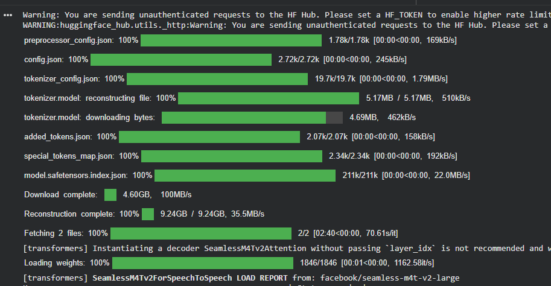
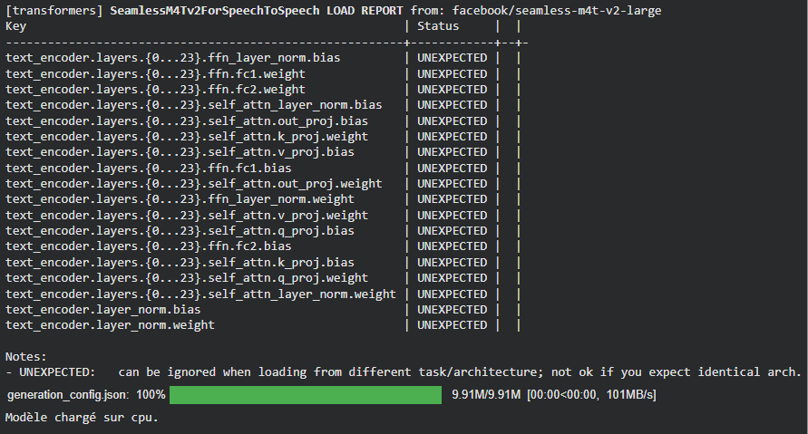

# Première traduction vocale — Installation et dépannage

## Objectif

Exécuter le notebook Python sur une phrase espagnole, écouter la traduction
anglaise et mesurer le temps de génération avant le fine-tuning.

## Essais d’installation

| Essai | Résultat observé | Cause |
| --- | --- | --- |
| Installer Transformers 4.57.1 avec la première version du notebook | pip a remplacé Transformers 5.22.1 et installé Hugging Face Hub 0.36.2. | Gradio 6.31.0 et Gradio Client 2.7.2 demandent Hub 1.16 ou plus. Diffusers 0.42.1 demande Hub 1.32 ou plus. |
| Rétablir Transformers 5.22.1 avec Hub ≥ 1.32 et < 3 | pip a installé Hub 2.4.0 et a signalé un nouveau conflit. | Datasets 4.8.5, déjà installé dans l’environnement, exige Hub < 2. |
| Conserver Transformers 5.22.1 et limiter Hub à ≥ 1.32 et < 2 | pip a désinstallé Hub 2.4.0 et installé Hub 1.33.0 avec succès. | Le minimum vient de Diffusers et le maximum vient de Datasets. Transformers et Gradio acceptent aussi cette plage. |

Le résolveur devait trouver une version commune. Diffusers exige au moins
la version 1.32 et Datasets exige une version strictement inférieure à 2.
La version 1.33.0 respecte ces deux limites. Elle respecte aussi le minimum
de Transformers 5.22.1 (1.31) et celui de Gradio et Gradio Client (1.16).

La ligne « Successfully installed » confirme que pip a installé les paquets
demandés. La vérification de l’ensemble des paquets de l’environnement se fait
avec pip check. À ce stade, les captures montrent des conflits d’installation.
Le chargement sur CPU et la première traduction ont ensuite été confirmés
dans Colab. Le fine-tuning reste à réaliser.

## Reprendre dans Jupyter ou Colab

1. Ouvrir [le notebook corrigé](01_premiere_traduction.ipynb). Si une copie est
   déjà ouverte, remplacer sa cellule d’installation par celle-ci.

   ~~~python
   %pip install "torch>=2.6" "transformers[sentencepiece]==5.22.1" "huggingface-hub>=1.32,<2" soundfile scipy
   ~~~

2. Redémarrer le noyau pour que Python utilise les versions qui viennent
   d’être installées. Exécuter la cellule suivante pour vérifier les dépendances.

   ~~~python
   %pip check
   ~~~

   Si pip signale encore un conflit, relever le nom du paquet et la plage
   de versions indiquée avant de modifier l’installation.

3. Placer un fichier WAV court nommé gracias_por_venir.wav à côté du notebook
   dans Jupyter ou l’importer dans le panneau Fichiers de Colab. Garder la langue
   cible eng pour la première traduction.
4. Écouter l’original, charger SeamlessM4T v2, puis exécuter la cellule de
   traduction. Au premier chargement, le notebook télécharge les paramètres
   du modèle. La référence attendue est « Thank you for coming. »
5. Noter la traduction réellement produite, vérifier le sens en écoutant
   l’audio et relever le temps de génération affiché.

## Avertissement HF_TOKEN au premier téléchargement

Si le notebook affiche « You are sending unauthenticated requests to the HF
Hub », le téléchargement se fait sans connexion à un compte Hugging Face.
Le modèle est public. **Tant que la barre de progression avance, laissez la
cellule s’exécuter.** Lors de notre essai dans Colab, le téléchargement
avançait malgré cet avertissement et affichait un total d’environ 9,24 Go.

Attendez le message « Modèle chargé sur cpu. » ou « Modèle chargé sur cuda. »,
selon l’appareil choisi, avant d’exécuter la cellule de traduction. Si une
erreur **HTTP 429** apparaît, Hugging Face a limité le nombre de requêtes.
Laissez le téléchargement reprendre après le délai indiqué ou utilisez un
jeton Hugging Face pour bénéficier des limites d’un compte connecté. Gardez
le jeton dans les secrets de Colab si vous utilisez cet environnement.

[Limites de requêtes sur Hugging Face Hub](https://huggingface.co/docs/hub/rate-limits)

## Rapport de chargement du modèle

Dans cet essai, les lignes `UNEXPECTED` concernent les poids de
`text_encoder`. Le modèle complet contient un encodeur de texte, tandis
que la classe `SeamlessM4Tv2ForSpeechToSpeech` reçoit de l’audio et utilise
un encodeur vocal. Ces poids supplémentaires sont donc attendus dans ce
cas précis. [Architecture de SeamlessM4T v2](https://huggingface.co/docs/transformers/model_doc/seamless_m4t_v2)

**« Modèle chargé sur cpu. »** confirme que la cellule de chargement est
terminée. Lancez ensuite la cellule **« Traduire et écouter »**.

## IndexError après la génération de l’audio

Colab a affiché `IndexError: invalid index of a 0-dim tensor` sur la ligne
`result.waveform_lengths[0].item()`.

Dans Colab, SeamlessM4T a renvoyé la longueur de l’audio sous la forme d’un
tenseur scalaire, c’est-à-dire une seule valeur sans dimension. L’ancienne
cellule essayait d’en lire le premier élément avec [0], ce qui provoquait
une erreur après la génération. Le notebook traite une seule phrase et
lit maintenant cette valeur avec item().

Si le noyau est toujours actif après cette erreur, la variable result
contient déjà le résultat. Il suffit d’exécuter les lignes d’affichage
corrigées dans une nouvelle cellule.

~~~python
length = result.waveform_lengths.item()
translated_audio = result.waveform.reshape(-1)[:length].float().cpu().numpy()
print(translation)
print(f"Temps de génération — {elapsed:.2f} s")
display(Audio(translated_audio, rate=model.config.sampling_rate))
~~~

## Première traduction confirmée dans Colab

Après la correction de l’affichage, le notebook a affiché la traduction et
le lecteur audio à partir du résultat déjà généré.

| Élément | Résultat observé |
| --- | --- |
| Phrase source | « Gracias por venir » |
| Traduction générée | « Thank you for coming. » |
| Modèle et appareil | SeamlessM4T v2 préentraîné, sur CPU dans Colab |
| Temps de génération | 64,09 secondes, hors chargement du modèle |

La sortie écrite correspond à la traduction de référence. Ce temps est la
mesure d’un seul essai et servira de point de comparaison pour une exécution
sur GPU avec le même fichier.

## Sources de l’installation

Les versions installées et les conflits proviennent des journaux pip.
Les éditeurs documentent les contraintes de Transformers et la publication
de Hub 1.33.0.

- [Dépendances de Transformers 5.22.1](https://github.com/huggingface/transformers/blob/v5.22.1/setup.py)
- [Versions de Hugging Face Hub sur PyPI](https://pypi.org/project/huggingface-hub/#history)
- [Documentation de pip check](https://pip.pypa.io/en/stable/cli/pip_check/)
